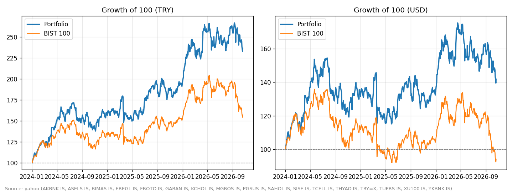
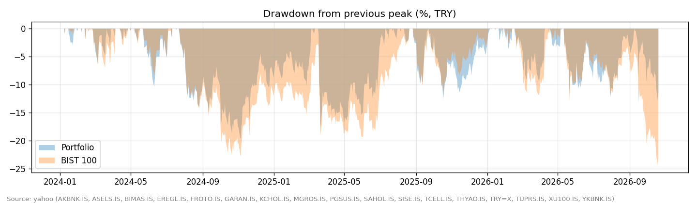

# BIST Portfolio Tracker & Economic Analysis

A Python project on a 15-stock Borsa Istanbul (BIST) portfolio across 8 sectors, in two parts:

1. **Tracker** (`bist_tracker.ipynb`): performance against the **BIST 100** in TRY and USD, risk metrics and an Excel report with live formulas.
2. **Economic analysis** (`bist_economics.ipynb`): how inflation, risk pricing and diversification work in a high-inflation emerging market.
   - **Real returns** with Turkish CPI (Fisher relation)
   - **CAPM** regressions with Newey-West standard errors and the Security Market Line
   - **Markowitz** efficient frontier, with an **out-of-sample test** against the 1/N portfolio
   - **Dividends:** price vs total return, and the benchmark bias of comparing with a price index
   - **Event study** of TCMB policy-rate decisions: BIST 100, bank stocks and USD/TRY, with event dates on the Borsa Istanbul trading calendar and a **placebo test** on random dates

I built it as an MSc student in Applied Economics & Data Analysis (JIBS), combining my FP&A background with econometrics and Python.

## What is simulated and what is real
| Part | Status | Details |
|---|---|---|
| Stock prices, BIST 100, USD/TRY | **Real** | Downloaded live (Yahoo Finance, borsapy, İş Yatırım) when you run the notebooks |
| CPI inflation and TCMB policy rate | **Real** | From the central bank via borsapy |
| Exchange holidays and half days | **Real** | Official Borsa Istanbul calendar (`exchange_calendars`, code XIST) |
| Portfolio positions | **Example** | 15 example holdings in `data/holdings_sample.csv`, not real investments |
| `sample_prices.csv`, `sample_macro.csv` | **Simulated** | Used only when there is no internet (`OFFLINE = True`) and by the tests |

Results in the notebooks come from live data. Each run prints which source was used, and says clearly when it falls back to simulated data.

## Research questions
- Did Turkish equities protect purchasing power, in real TRY and in USD terms?
- How much of each stock's risk is systematic (beta, R²), and is there any risk-adjusted excess return (alpha)?
- Does mean-variance optimisation beat naive 1/N diversification out of sample (DeMiguel, Garlappi & Uppal 2009)?
- How much of the return comes from dividends?
- How do stocks, banks and the lira react to central bank rate decisions?

## What it does
- Downloads daily prices for BIST stocks, the BIST 100 index and USD/TRY, with **three data sources and automatic fallback** (Yahoo Finance → borsapy → İş Yatırım)
- Calculates a **time-weighted return**, so buying new stocks over time does not distort performance
- Compares performance in **TRY and USD**: with high inflation, a TRY gain can be a USD loss
- Risk metrics: CAGR, volatility, Sharpe ratio, max drawdown, beta, tracking error, information ratio
- Charts: growth vs BIST 100, drawdowns, allocation and P/L, rolling volatility
- **Excel report** (openpyxl): Holdings sheet with formulas, a Metrics sheet and a chart

## Example output
Run the notebook and the charts appear here (saved in `output/`):




## Project structure
```
bist-portfolio-tracker/
├── bist_tracker.ipynb        # part 1: portfolio tracker (start here)
├── bist_economics.ipynb      # part 2: inflation, CAPM, Markowitz
├── tracker.py                # prices, returns, risk metrics, Excel report
├── econ.py                   # CPI/policy rate, real returns, CAPM, frontier, dividends, event study, trading calendar, placebo test
├── run_report.py             # builds the full report with one command
├── make_sample_prices.py     # creates simulated prices for offline testing
├── tests/                    # automated checks (pytest)
├── data/
│   ├── holdings_sample.csv   # 15 example positions with sectors (not real investments)
│   ├── sample_prices.csv     # SIMULATED prices, used only without internet
│   └── sample_macro.csv      # SIMULATED CPI and policy rate, used only without internet
└── output/                   # Excel report + charts (created when you run it)
```

## How to run
```bash
pip install -r requirements.txt
jupyter notebook bist_tracker.ipynb      # or open it in VS Code
# or, without Jupyter:
python run_report.py --rf 0.35           # 0.35 = 35% annual TRY risk-free rate
pytest -q                                # automated checks, offline
```
The tests check the core calculations on hand-made examples: the time-weighted return ignores new money, the real index is flat when prices only follow inflation, and more.

To track your own portfolio, copy `data/holdings_sample.csv` to `data/my_holdings.csv` and edit it. For each stock give either `shares` or `amount_try` (TRY invested). Files named `my_*.csv` are excluded from GitHub by `.gitignore`, so your positions stay private.

## Data sources
| Order | Source | Package | Covers |
|---|---|---|---|
| 1 | Yahoo Finance | `yfinance` | stocks, BIST 100, USD/TRY |
| 2 | TradingView and doviz.com | `borsapy` | stocks, BIST 100, USD/TRY |
| 3 | İş Yatırım website | `isyatirimhisse` | stocks, BIST 100 |
| macro | TCMB (central bank) | `borsapy` | monthly CPI inflation, policy rate |

If one source is missing a series, the next one fills the gap. The report records which source each series came from.
These are free, unofficial sources: good for a personal tracker, not for official reporting.
Choose the order with `python run_report.py --sources borsapy,yahoo`.

## Methods
| Metric | Formula |
|---|---|
| Time-weighted daily return | (Value_t − new money_t) / Value_t−1 − 1 |
| CAGR | (1 + total return)^(1/years) − 1 |
| Annual volatility | std(daily returns) × √252 |
| Sharpe ratio | mean(excess daily return) / std × √252 |
| Max drawdown | min(Value / running peak − 1) |
| Beta | cov(portfolio, BIST 100) / var(BIST 100) |
| Real return | (1 + nominal return) / (1 + CPI inflation) − 1 |
| CAPM | r_i − r_f = α_i + β_i (r_m − r_f) + ε_i, OLS on weekly data, Newey-West SEs |
| Efficient frontier | min w'Σw s.t. w'μ = target, Σw = 1, 0 ≤ w ≤ 25% |
| Dividend contribution | annualised total return (adjusted close) − annualised price return |
| Event study | AR = r − (a + b·r_m), estimated on days −150 to −11; CAR over days 0 to +1 |
| Event day 0 | First Borsa Istanbul session open at or after the 14:00 announcement (holidays and half days from the XIST calendar) |
| Placebo test | Average CAR on 500 sets of random non-event days; empirical p-value = share at least as large as the real one |

## Limitations and next steps
- The tracker uses dividend-adjusted stock prices but the BIST 100 is a price index, so its excess return is flattered by roughly the dividend yield (quantified in part 2)
- No transaction costs or taxes
- In-sample estimates of means are noisy; see the out-of-sample test in part 2
- The event study groups decisions by direction only; it has no measure of surprise
- Next: rate surprises from consensus forecasts, multi-factor models, GARCH volatility

## References
- Markowitz (1952), *Journal of Finance*; Sharpe (1964), *Journal of Finance*; Lintner (1965), *Review of Economics and Statistics*
- Newey & West (1987), *Econometrica*; Fama & French (2004), *Journal of Economic Perspectives*
- DeMiguel, Garlappi & Uppal (2009), *Review of Financial Studies*
- MacKinlay (1997), Event Studies in Economics and Finance, *Journal of Economic Literature*

## Tools
Python (pandas, NumPy, statsmodels, SciPy, Matplotlib, openpyxl, yfinance, borsapy), pytest, Jupyter, Excel

*Educational project. Not investment advice.*

## License
MIT. See [LICENSE](LICENSE).
